<p align="center">
  
</p>

# Dead Space 2008 Randomizer: Console DLC

An add-on for the [Dead Space 2008 Randomizer](https://github.com/RichardHafer/DS2008-Randomizer)
that brings the console DLC suits and weapons of the original Dead Space (2008)
to the PC version. Everything sits in the store for free, in every chapter,
with the stats the packs had on console.

The PC game still carries the console DLC framework, it just never gets any
content. This plugin fills it with the packs converted to PC data, and the
game does the rest itself: store, equipping, weapon models, effects and sounds.

It is a separate plugin and needs the randomizer next to it. The randomizer
finds it on start, calls it from its own hooks and shows its options in the
settings window. Without the add-on the randomizer runs as usual.

## What it does

**Console packs**

| | |
|---|---|
| Scorpion | Suit, Force Gun, Line Gun, Plasma Cutter |
| Obsidian | Suit, Line Gun, Plasma Cutter, Pulse Rifle |
| Elite | Suit, Line Gun, Plasma Cutter, Pulse Rifle (the Xbox pack) |
| Unitology (Tank) | Suit, Flamethrower, Force Gun, Line Gun |
| Astronaut | Suit, Plasma Cutter, Pulse Rifle, Ripper |
| Military | Contact Beam, Flamethrower, Force Gun, Line Gun, Plasma Cutter, Pulse Rifle, Ripper |
| Weapon packs | Heavy Damage, Hot Rod, Pedestrian, Speed Kills, Big Gun |

**Level suits in DLC style**

| | |
|---|---|
| Scorpion, Obsidian, Unitology, Elite, Astronaut | Levels 1 to 6 in each look |
| Military | Levels 1 to 5 |
| Mining Rig | Level 1 |

Each one carries the inventory and armour of the level suit it is built on, so
a Scorpion level 2 plays like the regular level 2 suit.

**Engine limits**

| | |
|---|---|
| Suit table | The game holds 30 suits. The plugin raises the table to 64 (`SuitSlots`) so all of the above fit. |

**Off by default, turn on in the INI or in the settings window**

| | |
|---|---|
| `SuitPaths` | A seed may play a whole run in one DLC style. Level 1 is worn from New Game, levels 2 to 6 take the store places, prices and unlocks of the retail suits, and the style's weapons replace the retail weapons of their type. `SuitPathWeaponPacks` may add a weapon-only pack for the types left. Once the run is finished (New Game+) every DLC item is back in the store for free. |

Every patch site is checked against the Steam bytes before it is placed, and
the log says which ones went in.

## Install

### Windows

**[Download the latest release](https://github.com/RichardHafer/DS2008-ConsoleDLC/releases/latest)**

Install the [randomizer](https://github.com/RichardHafer/DS2008-Randomizer/releases/latest)
first. Then close the game and extract this archive into the game folder
(Steam: right-click Dead Space > Manage > Browse local files, the folder with
`Dead Space.exe`). The installed files should look like this:

```text
Dead Space/
|-- winmm.dll                                   (from the randomizer)
|-- DeadSpace2008Randomizer.ini
|-- plugins/
|   |-- DeadSpace2008Randomizer.asi             (the randomizer)
|   `-- DeadSpace2008Randomizer_ConsoleDLC.asi  (this add-on)
`-- ds1_randomizer_assets/
    `-- dlc/
        `-- *.str                               (the converted packs)
```

Start the game. `DeadSpace2008Randomizer.log` has an `extension: ... attached`
line when the add-on is in use, and the Console DLC page of the settings window
is no longer greyed out.

Settings go into `DeadSpace2008Randomizer.ini`, section `[DeadSpace2008Randomizer]`,
or the settings window:

| Key | Default | |
|---|---|---|
| `ConsoleDlc` | 1 | The DLC suits and weapons in the store. |
| `SuitSlots` | 64 | Size of the suit table (30 in the original game). |
| `SuitPaths` | 0 | Seeded runs in one DLC style. |
| `SuitPath_<name>` | 1 | Which styles a suit path may pick. |
| `SuitPathWeaponPacks` | 1 | A suit path may add a weapon-only pack. |

To uninstall, delete `plugins\DeadSpace2008Randomizer_ConsoleDLC.asi` and the
`ds1_randomizer_assets\dlc` folder. Keep it installed while you play a save
that holds DLC items.

If something goes wrong, send `DeadSpace2008Randomizer.log` (and
`DeadSpace2008Randomizer.prev.log` after a crash) with a short description.

---

## How it works

Not required reading. This is here so the next person does not have to redo
the research.

### The DLC manager

The PC executable still has the console DLC manager (at `0x00F64A68`) with its
store lists, uniform slots and weapon entries. On console a pack registered
its archives there; on PC the manager simply stays empty. The plugin fills its
entries once `global_assets` has loaded, marks the store archives persistent
so a level change does not drop them, and lets the game load everything else
on demand, the same way it would for a console pack.

### Converting the packs

The archives are converted offline from the console packs:

- Scene data is converted from big-endian, with each property's width taken
  from the PC class tables (a byte property swapped as a word made every DLC
  shot bounce off).
- Models, rigs, banks and effects the PC already ships under the same name are
  taken from the PC data.
- DLC-only textures keep their pixels (both platforms use DXT) with a PC header.
- DLC meshes are converted from the console geometry.
- The level suits in DLC style are repainted from the level suits with the
  pack's paint, plates and decals.

### Working with the randomizer

The randomizer's extension interface is `src/ds2008_extension.h`. The add-on
never hooks a function the randomizer hooks: the randomizer calls it from its
own stream, store and poll hooks, and hands it stream state, verified hook
sites and the seed.

## Building

Visual Studio 2022 with the x86 toolchain, then `build.bat`. safetyhook needs
`std::expected`, hence `/std:c++latest`.

The `src/*_generated.inc` tables come from the pack conversion and are
committed, so the plugin builds without the console data.

The converted archives are game data and are not part of the repository. To
build them yourself you need the console packs (`DLCs/extracted/<pack>`), the
PC game, Python 3 with numpy and Pillow, and Gibbed's Visceral tools
(`Gibbed.Visceral.StrUnpack.exe` and `StrPack.exe` in `tools/gibbed`, or set
`GIBBED_VISCERAL_DIR`):

```bat
set DEAD_SPACE_DIR=C:\Program Files (x86)\Steam\steamapps\common\Dead Space
python -I tools\ds1_dlc_build.py
python -I tools\make_release.py assets_dlc --version 1.0.0
```

`make_release.py` packs only the archives the plugin's table lists.

## Credits

- [safetyhook](https://github.com/cursey/safetyhook) and [Zydis](https://github.com/zyantific/zydis) for hooking
- Gibbed for the Visceral archive tools
- Everyone who played test runs and sent logs

## Licence

MIT, see `LICENSE`. Not affiliated with EA or Visceral Games. The DLC content
belongs to EA.
